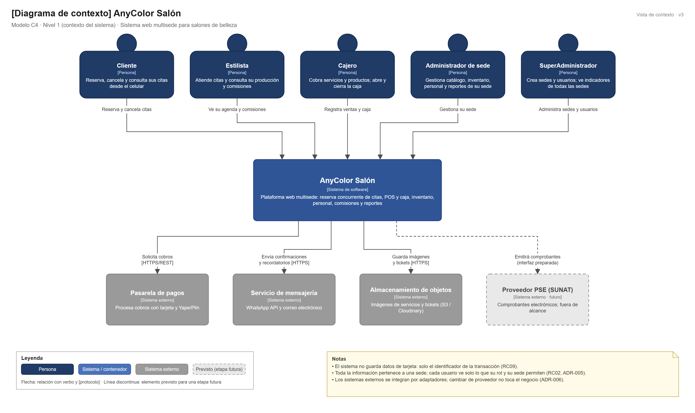

# AnyColor Salón – Arquitectura de Software

| | |
|---|---|
| **Curso** | IS-488 Arquitectura de Software |
| **Estudiante** | Conde Cayllahua, Andy Rodrigo |
| **Docente** | Ing. Lizbeth Jaico Quispe |
| **Proyecto** | Sistema Web Multisede para la Gestión Operativa, Reserva Concurrente de Citas y Control de Ventas en Salones de Belleza |
| **Periodo** | 2026-II · Primer sprint (Guía 04) |

AnyColor Salón es un sistema web para cadenas de salones de belleza con varias sedes. Hoy esos salones agendan por WhatsApp y cuadernos; el sistema centraliza **citas, caja (POS), inventario, personal con comisiones y reportes**. Su reto principal es **evitar cruces de horario** cuando muchas clientas reservan a la vez.

---

## ¿Dónde encuentro…?

| Busco | Documento |
|---|---|
| El problema del negocio | [00 · Necesidad del negocio](docs/01-analisis-de-sistema/00-necesidad-del-negocio.md) |
| Los actores (usuarios y sistemas externos) | [01 · Actores](docs/01-analisis-de-sistema/01-actores.md) |
| Las historias de usuario | [02 · Historias de usuario](docs/01-analisis-de-sistema/02-historias-del-usuario.md) |
| Los requisitos funcionales | [03 · Requisitos funcionales](docs/01-analisis-de-sistema/03-requisitos-funcionales.md) |
| **Los atributos de calidad** | [04 · Atributos de calidad](docs/01-analisis-de-sistema/04-atributos-de-calidad.md) |
| **Los atributos de calidad medibles (escenarios)** | [08 · Escenarios de atributos de calidad](docs/01-analisis-de-sistema/08-escenarios-atributos-calidad.md) |
| Las restricciones | [05 · Restricciones](docs/01-analisis-de-sistema/05-restricciones.md) |
| Los drivers arquitectónicos | [06 · Drivers arquitectónicos](docs/01-analisis-de-sistema/06-driver-arquitectonicos.md) |
| Las decisiones (ADR) | [07 · Decisiones arquitectónicas](docs/01-analisis-de-sistema/07-decisiones-arquitectonicas.md) |
| Los módulos del sistema | [Componentes arquitectónicos](docs/02-arquitectura-software/componentes-arquitectonicos.md) · [C4 nivel 3](docs/04-modelo-c4/Nivel3-Diagrama-de-Componentes.md) |
| Cómo se manejan las citas sin cruces | [Diseño interno del módulo Citas](docs/03-diseño-de-software/diseño-interno/diseño-interno-de-modulos.md) · [C4 nivel 4](docs/04-modelo-c4/Nivel4-DiagramadeCodigo.md) |
| El estilo arquitectónico | [Estilo: monolito modular + SPA](docs/02-arquitectura-software/estilo-arquitectonico.md) |
| El enfoque arquitectónico | [Enfoque: Clean Architecture](docs/02-arquitectura-software/enfoque-arquitectonico.md) |
| Los patrones y principios SOLID | [Patrones](docs/03-diseño-de-software/diseño-interno/patrones-de-diseño.md) · [SOLID](docs/03-diseño-de-software/diseño-interno/principios-de-diseño.md) |
| El modelo C4 | [Nivel 1](docs/04-modelo-c4/Nivel1-DiagramadeContextodelSistema.md) · [Nivel 2](docs/04-modelo-c4/Nivel2-DiagramadeContenedores.md) · [Nivel 3](docs/04-modelo-c4/Nivel3-Diagrama-de-Componentes.md) · [Nivel 4](docs/04-modelo-c4/Nivel4-DiagramadeCodigo.md) |
| El código | [tecnologia/anycolor-core](tecnologia/anycolor-core/) |
| La propuesta (Word) | [propuesta/](propuesta/) |
| La presentación | [presentacion/](presentacion/) |

---

## Arquitectura en una mirada



| Decisión | Qué elegimos | Por qué |
|---|---|---|
| Estilo | Monolito modular + SPA | Venta, inventario y comisión se guardan en una sola transacción; equipo pequeño |
| Enfoque | Clean Architecture en cada módulo | Las reglas del salón no dependen de la base de datos ni de los proveedores |
| Comunicación | API REST con JSON sobre HTTPS | El frontend y el backend se despliegan por separado |
| Datos | PostgreSQL (fuente de verdad) + Redis (bloqueo de 5 min y caché) | Cero citas cruzadas aunque reserven muchas clientas a la vez |
| Escala | API sin estado detrás de un balanceador | Soportar más de 10 000 usuarios en campañas |

**Módulos (8):** Usuarios y Sedes · Catálogo · Citas · POS y Caja · Inventario · Personal y Comisiones · Reportes · Notificaciones.

---

## Estructura del repositorio

```text
docs/
├── 01-analisis-de-sistema/       00 a 08: problema, actores, HU, RF, calidad, restricciones, drivers, ADR, escenarios
├── 02-arquitectura-software/     arquitectura inicial, componentes, enfoque y estilo
├── 03-diseño-de-software/
│   └── diseño-interno/           diseño interno de módulos, patrones y principios SOLID
└── 04-modelo-c4/                 niveles 1 a 4 del modelo C4
img/                              diagramas PNG (img/fuentes: draw.io y SVG editables)
tecnologia/anycolor-core/         núcleo Clean Architecture en TypeScript con pruebas
propuesta/                        propuesta del proyecto v1, v2 y v3 + historial de versiones
presentacion/                     diapositivas del primer sprint
```

## Ejecutar las pruebas del núcleo

```bash
cd tecnologia/anycolor-core
npm install
npm run pruebas      # 16 pruebas: citas concurrentes, expiración de 5 min, POS idempotente, inventario
```
