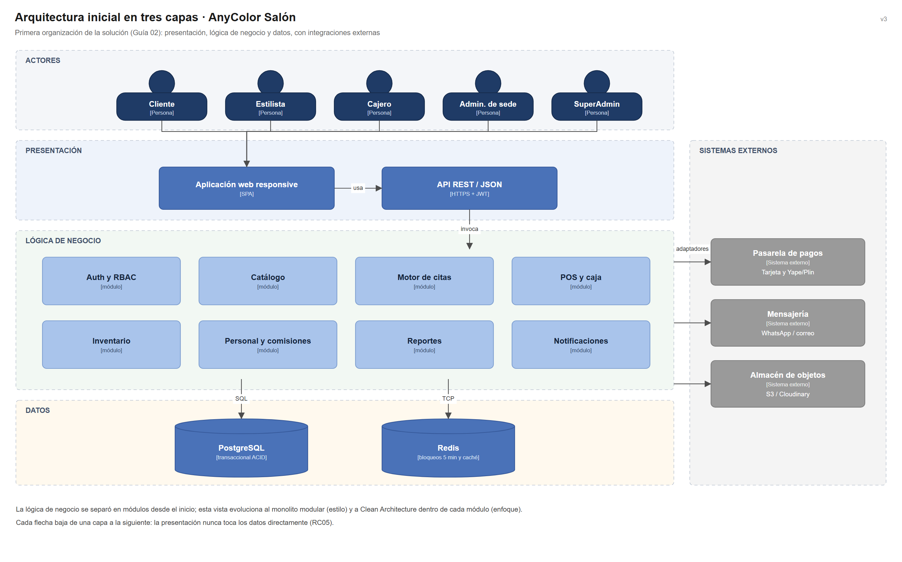

# Arquitectura inicial del sistema

## Diagrama de arquitectura

> Archivo editable: [`img/fuentes/arquitectura-inicial.drawio`](../../img/fuentes/arquitectura-inicial.drawio)

## Descripción

La arquitectura inicial organiza la solución en tres capas y un grupo de sistemas externos:

| Capa | Elementos | Responsabilidad |
|---|---|---|
| **Presentación** | Aplicación web responsive, API REST/JSON | Permite que clientes, estilistas, cajeros y administradores usen el sistema desde el navegador; la API recibe las peticiones por HTTPS con token JWT. |
| **Lógica de negocio** | Auth y RBAC, Catálogo, Motor de citas, POS y caja, Inventario, Personal y comisiones, Reportes, Notificaciones | Aplica las reglas del salón: reservas sin cruces, ventas, stock por sede, comisiones y reportes. |
| **Datos** | PostgreSQL, Redis | PostgreSQL guarda la información transaccional (ACID). Redis mantiene los bloqueos temporales de 5 minutos y la caché del catálogo. |
| **Sistemas externos** | Pasarela de pagos, mensajería, almacén de objetos | Se conectan mediante adaptadores para poder cambiarlos sin tocar la lógica de negocio. |

## Reglas de la vista

- Cada capa solo usa a la capa inmediata inferior: la aplicación web nunca accede a PostgreSQL ni a Redis (RC05).
- Toda la información pertenece a una sede (RC02), por eso Auth y RBAC filtra cada operación por rol y sede.
- Las integraciones externas pasan siempre por un adaptador (RC08).

## Evolución

Esta vista es el punto de partida. A partir de los drivers arquitectónicos se refinó en:

1. el **estilo** monolito modular con API sin estado ([estilo-arquitectonico.md](estilo-arquitectonico.md));
2. el **enfoque** Clean Architecture dentro de cada módulo ([enfoque-arquitectonico.md](enfoque-arquitectonico.md));
3. los **componentes arquitectónicos** con su trazabilidad ([componentes-arquitectonicos.md](componentes-arquitectonicos.md)).
