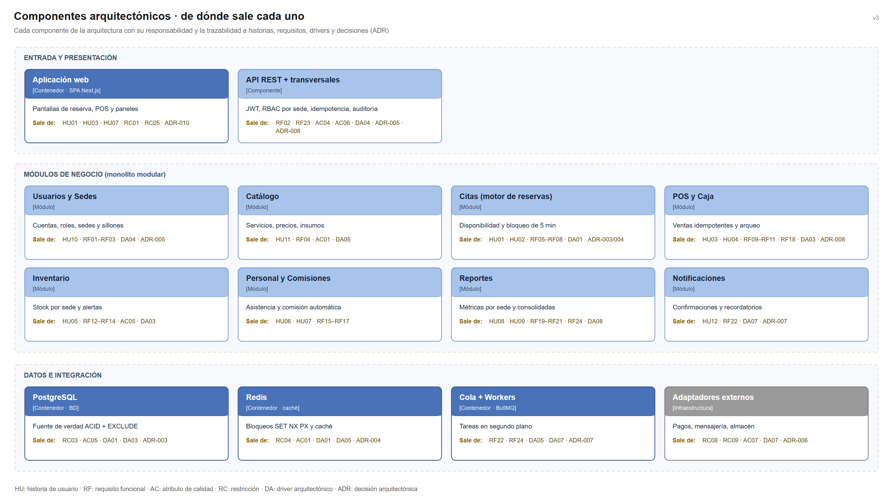

# Componentes arquitectónicos

Cada componente responde a una necesidad concreta del análisis. La columna **Sale de** permite contestar, para cualquier caja de los diagramas, de qué historia, requisito, atributo, restricción, driver o decisión proviene.

## Entrada y presentación

| Componente | Tipo | Responsabilidad | Sale de |
|---|---|---|---|
| Aplicación web | Contenedor · SPA Next.js/React | Pantallas de reserva para clientes, POS para cajeros y paneles para estilistas y administradores | HU01, HU03, HU07 · RC01, RC05 · ADR-010 |
| API REST + transversales | Componente del backend | Rutas `/api/v1`, autenticación JWT, RBAC por sede, validación, idempotencia y auditoría | RF02, RF23 · AC04, AC06 · DA04 · ADR-005, ADR-008 |

## Módulos de negocio (monolito modular)

| Componente | Responsabilidad | Sale de |
|---|---|---|
| Usuarios y Sedes | Cuentas, roles, sedes, sillones y estaciones | HU10 · RF01–RF03 · DA04 · ADR-005 |
| Catálogo | Servicios, precios, duración, insumos y estilistas habilitados | HU11 · RF04 · AC01 · DA05 |
| Citas (motor de reservas) | Disponibilidad, bloqueo de 5 minutos y estados de la cita | HU01, HU02 · RF05–RF08 · DA01 · ADR-003, ADR-004 |
| POS y Caja | Ventas idempotentes, cobros, apertura, arqueo y cierre de caja | HU03, HU04 · RF09–RF11, RF18 · DA03 · ADR-008 |
| Inventario | Stock por sede, descuento transaccional, ajustes y alertas | HU05 · RF12–RF14 · AC05 · DA03 |
| Personal y Comisiones | Asistencia, turnos y comisión por servicio finalizado | HU06, HU07 · RF15–RF17 |
| Reportes | Métricas por sede y consolidadas, exportación | HU08, HU09 · RF19–RF21, RF24 · DA08 · ADR-009 |
| Notificaciones | Confirmaciones, recordatorios y alertas de stock | HU12 · RF22 · DA07 · ADR-007 |

## Datos e integración

| Componente | Tipo | Responsabilidad | Sale de |
|---|---|---|---|
| PostgreSQL | Contenedor · base de datos | Fuente de verdad ACID; restricción `EXCLUDE` contra citas solapadas | RC03 · AC05 · DA01, DA03 · ADR-003 |
| Redis | Contenedor · caché | Bloqueos `SET NX PX` de 5 minutos y caché del catálogo | RC04 · AC01, AC05 · DA01, DA05 · ADR-004 |
| Cola + Workers | Contenedor · BullMQ | Recordatorios, tickets PDF y exportaciones en segundo plano | RF22, RF24 · DA05, DA07 · ADR-007 |
| Adaptadores externos | Infraestructura | Traducen pagos, mensajería y almacenamiento al lenguaje de cada proveedor | RC08, RC09 · AC07 · DA07 · ADR-006 |
| Réplica de lectura | Contenedor · etapa 3 | Reportes pesados sin cargar la base transaccional | RC12 · DA08 · ADR-009 |

## Relación con los diagramas C4

| Vista | Dónde aparecen estos componentes |
|---|---|
| Nivel 2 – Contenedores | Aplicación web, API AnyColor, PostgreSQL, Redis, Workers, réplica |
| Nivel 3 – Componentes | API REST y los ocho módulos de negocio |
| Nivel 4 – Código | Clases del módulo Citas y sus adaptadores |

Ver [`docs/04-modelo-c4`](../04-modelo-c4/).
