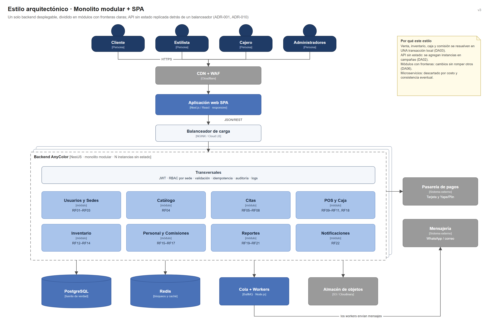

# Estilo arquitectónico seleccionado

**Estilo:** monolito modular (backend) con organización interna en capas, más un frontend SPA desacoplado por API REST. Decisión registrada en ADR-001 y ADR-010 ([07-decisiones-arquitectonicas.md](../01-analisis-de-sistema/07-decisiones-arquitectonicas.md)).

## Justificación

| Criterio | Cómo lo satisface el estilo |
| --- | --- |
| Escalabilidad (DA02) | La API es **sin estado**: se replican instancias detrás de un balanceador. |
| Consistencia (DA01, DA03) | Venta, inventario, caja y comisión se resuelven en **una transacción local** de PostgreSQL. |
| Mantenibilidad (DA06) | Módulos con fronteras claras; cada módulo con Clean Architecture (ver [enfoque-arquitectonico.md](enfoque-arquitectonico.md)). |
| Costo y operación | Una sola unidad de despliegue para el MVP. |
| Evolución | Los módulos más calientes (Citas, Reportes) pueden extraerse después. |

## Diagrama del estilo

> Archivo editable: [`img/fuentes/estilo-monolito-modular.drawio`](../../img/fuentes/estilo-monolito-modular.drawio)

## Alternativas evaluadas

| Alternativa | Por qué se descartó |
| --- | --- |
| Microservicios | Venta, inventario, caja y comisión necesitan una transacción local; separarlos obliga a consistencia eventual, más despliegues y más latencia. Costo injustificado para un equipo de una persona. |
| Monolito sin módulos | Es más rápido al inicio, pero mezcla responsabilidades y rompe la mantenibilidad (DA06). |
| Páginas generadas en el servidor | Acopla interfaz y backend; la SPA permite desplegar el frontend en CDN y evolucionarlo por separado (ADR-010). |

## Límites del estilo

* El frontend **nunca** habla directo con Redis ni con PostgreSQL: solo consume la API REST.
* Un módulo no lee las tablas de otro: se comunica por su caso de uso o por un evento.
