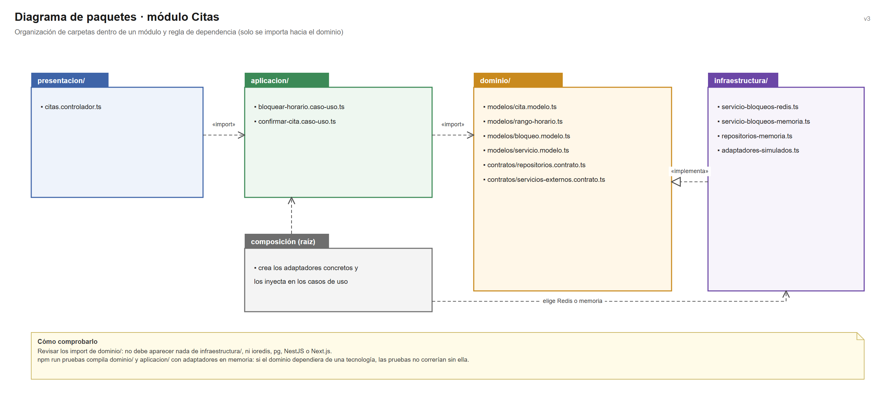
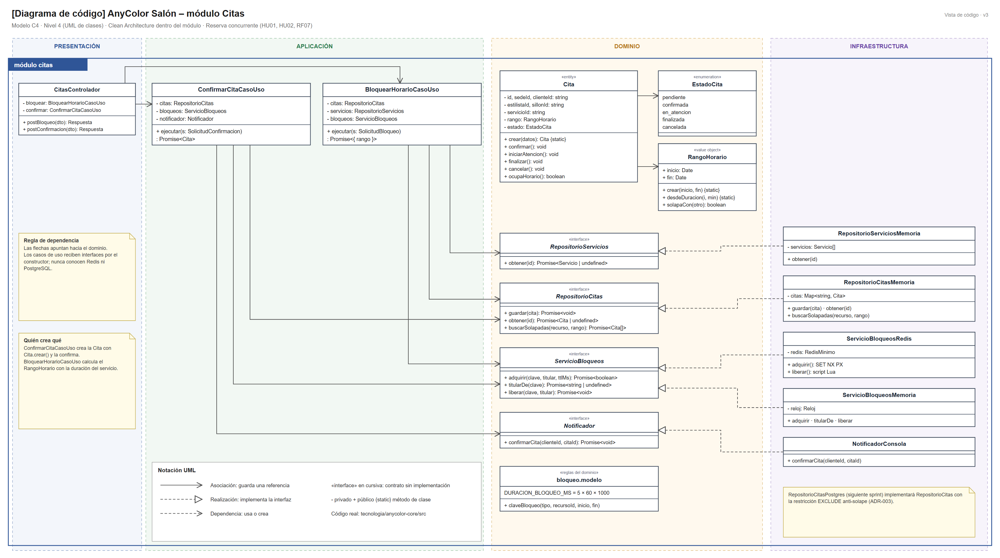
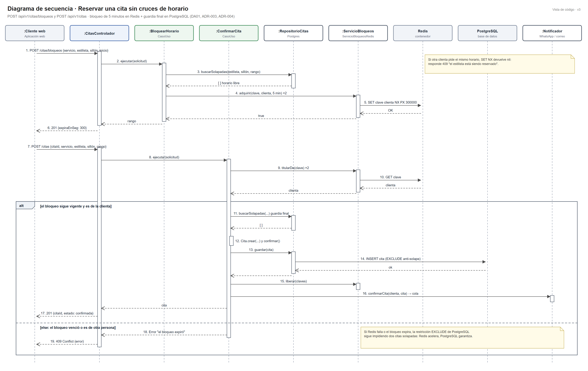
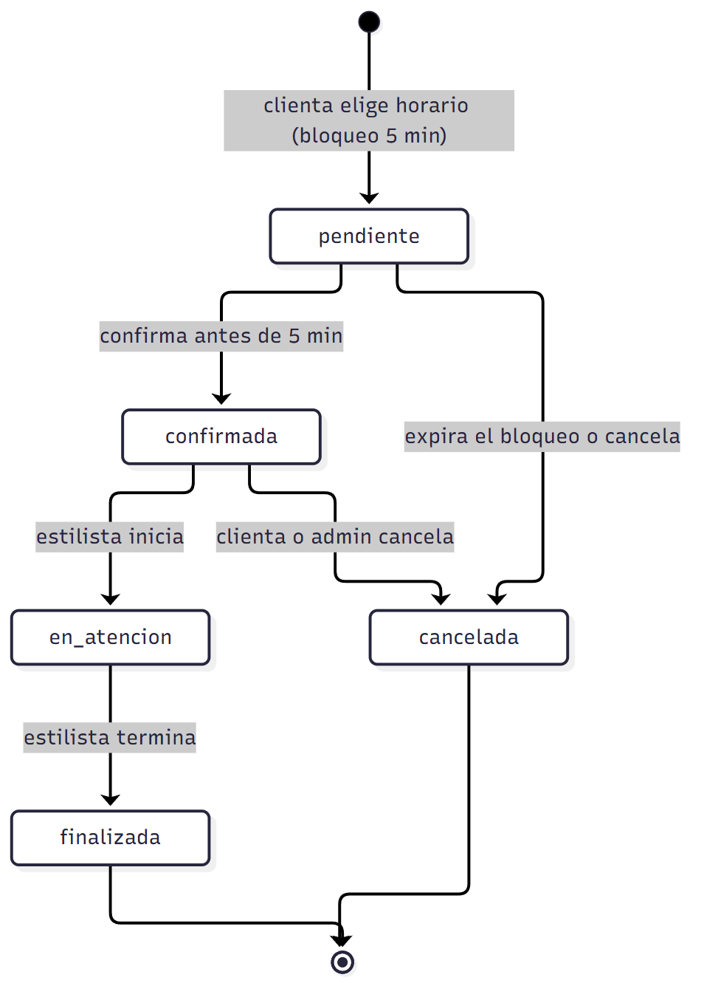
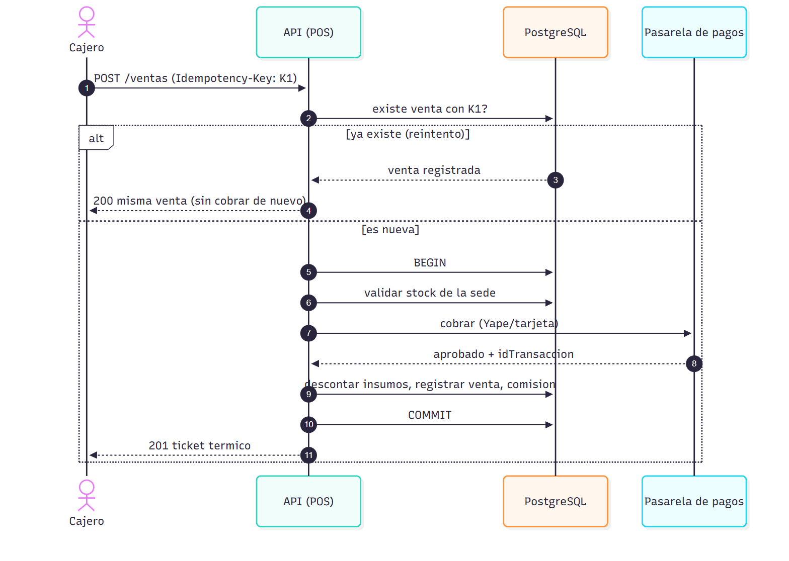
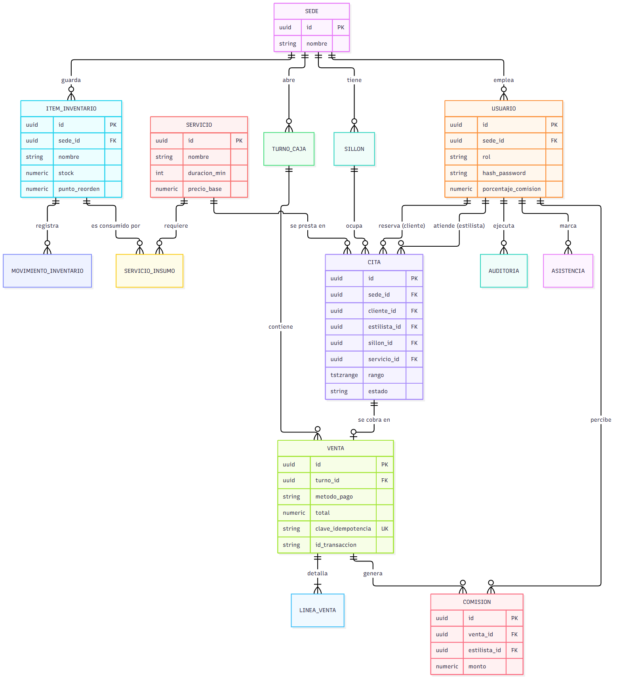

# Diseño interno de módulos

> **Proyecto:** AnyColor Salón · **Backend:** Node.js + TypeScript (NestJS) · **Módulo de referencia:** Citas
> **Enfoque arquitectónico:** Clean Architecture dentro de cada módulo del monolito modular
> **Nivel C4:** 4 – Código · **Versión:** 3.0

---

## 1. Propósito

Este documento describe **cómo se organiza el código dentro de un módulo** del backend, para que:

- todos los módulos (Citas, POS y Caja, Inventario, etc.) se construyan con la misma estructura;
- las reglas del salón queden aisladas de Redis, PostgreSQL y los proveedores externos;
- cualquier integrante sepa dónde va cada archivo y de qué puede depender.

Se toma **Citas** como módulo de referencia porque concentra el driver más exigente (DA01: reservas sin cruces con muchas clientas a la vez).

## 2. Estructura de carpetas

Estructura objetivo de cada módulo en el backend NestJS:

```text
src/
└── modules/
    └── citas/
        ├── dominio/
        │   ├── modelos/
        │   │   ├── cita.modelo.ts                  Entidad Cita y su máquina de estados
        │   │   ├── rango-horario.ts                Objeto de valor: inicio, fin y solapes
        │   │   └── bloqueo.modelo.ts               Regla de 5 minutos y clave del bloqueo
        │   └── contratos/
        │       ├── repositorios.contrato.ts        RepositorioCitas, RepositorioServicios
        │       └── servicios-externos.contrato.ts  ServicioBloqueos, Notificador
        ├── aplicacion/
        │   ├── bloquear-horario.caso-uso.ts        HU02 · RF07
        │   └── confirmar-cita.caso-uso.ts          HU01 · RF06
        ├── infraestructura/
        │   ├── servicio-bloqueos-redis.ts          SET NX PX + liberación con script Lua
        │   ├── repositorio-citas-postgres.ts       SQL + restricción EXCLUDE (siguiente sprint)
        │   └── notificador-whatsapp.ts             API de mensajería (etapa 2)
        ├── presentacion/
        │   └── citas.controlador.ts                POST /api/v1/citas/bloqueos y /api/v1/citas
        ├── citas.module.ts                         Raíz de composición del módulo
        └── index.ts                                API pública del módulo
```

En el sprint 1 el núcleo ejecutable está en [`tecnologia/anycolor-core/src`](../../../tecnologia/anycolor-core/src), organizado por capas con los mismos nombres de archivo.

| Archivo | Capa | Responsabilidad | Importa de |
|---|---|---|---|
| `cita.modelo.ts` | Dominio | Crear citas válidas y controlar sus transiciones de estado | `rango-horario.ts` |
| `rango-horario.ts` | Dominio | Validar el rango y detectar solapes | Nada |
| `bloqueo.modelo.ts` | Dominio | Duración del bloqueo (5 min) y clave por recurso | Nada |
| `repositorios.contrato.ts` | Dominio | Declarar **qué** persistencia necesita el módulo | Modelos del dominio |
| `servicios-externos.contrato.ts` | Dominio | Declarar **qué** se necesita para bloquear y notificar | Nada |
| `bloquear-horario.caso-uso.ts` | Aplicación | Validar servicio y estilista, revisar solapes y bloquear estilista + sillón | Dominio |
| `confirmar-cita.caso-uso.ts` | Aplicación | Verificar el bloqueo, aplicar la guardia final, guardar, liberar y notificar | Dominio |
| `servicio-bloqueos-redis.ts` | Infraestructura | Implementar `ServicioBloqueos` con Redis | Dominio + cliente Redis |
| `servicio-bloqueos-memoria.ts` | Infraestructura | Implementación para pruebas con reloj simulado | Dominio |
| `repositorios-memoria.ts` | Infraestructura | Repositorios en memoria para pruebas | Dominio |
| `citas.controlador.ts` | Presentación | Traducir el DTO HTTP al caso de uso y el resultado a 201/409 | Aplicación |
| `citas.module.ts` | Composición | Elegir implementaciones concretas e inyectarlas | Todas |

---

## 3. Capas del módulo y regla de dependencia



**Regla de dependencia:** el código solo importa hacia el centro (dominio). El dominio no conoce NestJS, PostgreSQL ni Redis.

| Capa | Contiene | Responsabilidad | Puede depender de | **No** puede depender de |
|---|---|---|---|---|
| **Dominio** | Entidades, objetos de valor, contratos | Reglas del salón que serían ciertas con cualquier tecnología | Nada externo | Aplicación, infraestructura, presentación, NestJS, ORM, Redis |
| **Aplicación** | Casos de uso | Orquestar el flujo: qué paso va primero y qué hacer si falla | Dominio | Infraestructura, presentación |
| **Infraestructura** | Repositorios y adaptadores | Implementar los contratos con una tecnología | Dominio, librerías externas | Aplicación, presentación |
| **Presentación** | Controladores, DTO | Traducir HTTP a casos de uso y viceversa | Aplicación | Infraestructura, base de datos |
| **Composición** | `citas.module.ts` | Conectar implementaciones concretas | Todas | — |

> **Cómo comprobarlo:** revisar los `import` de `dominio/`. Si aparece `ioredis`, `pg`, `@nestjs/*` o un archivo de `infraestructura/`, la regla se rompió.

---

## 4. Diagrama de clases



El detalle de cada clase está en [Nivel4-DiagramadeCodigo.md](../../04-modelo-c4/Nivel4-DiagramadeCodigo.md).

## 5. Flujo de ejecución: reservar una cita



| Paso | Origen → destino | Acción | Capa |
|---|---|---|---|
| 1 | Cliente web → `CitasControlador` | `POST /api/v1/citas/bloqueos` con servicio, estilista, sillón e inicio | Presentación |
| 2 | `CitasControlador` → `BloquearHorarioCasoUso` | `ejecutar(solicitud)` | Presentación → Aplicación |
| 3 | `BloquearHorarioCasoUso` → `RepositorioCitas` | `buscarSolapadas()`: el horario debe estar libre | Aplicación → Dominio (contrato) |
| 4–5 | `BloquearHorarioCasoUso` → `ServicioBloqueos` → Redis | `adquirir()` para estilista y sillón: `SET NX PX 300000` | Aplicación → Infraestructura |
| 6 | `CitasControlador` → Cliente web | `201` con 300 s para confirmar | Presentación |
| 7–8 | Cliente web → `ConfirmarCitaCasoUso` | `POST /api/v1/citas` | Presentación → Aplicación |
| 9–10 | `ConfirmarCitaCasoUso` → `ServicioBloqueos` | `titularDe()`: el bloqueo debe seguir siendo de la clienta | Aplicación → Infraestructura |
| 11 | `ConfirmarCitaCasoUso` → `RepositorioCitas` | Guardia final: `buscarSolapadas()` en la fuente de verdad | Aplicación → Dominio |
| 12 | `ConfirmarCitaCasoUso` → `Cita` | `Cita.crear()` y `confirmar()` | Aplicación → Dominio |
| 13–14 | `RepositorioCitas` → PostgreSQL | `INSERT` protegido por `EXCLUDE USING gist` | Infraestructura → BD |
| 15–17 | — | Libera bloqueos, notifica y responde `201` | Aplicación → Presentación |
| 18–19 | Alternativa | Si el bloqueo venció o es de otra persona: `409 Conflict` | Aplicación → Presentación |

## 6. Estados de la cita



| Estado actual | Puede pasar a | Método |
|---|---|---|
| pendiente | confirmada, cancelada | `confirmar()`, `cancelar()` |
| confirmada | en_atencion, cancelada | `iniciarAtencion()`, `cancelar()` |
| en_atencion | finalizada | `finalizar()` |
| finalizada | — | — |
| cancelada | — (libera el horario) | — |

Cualquier otra transición lanza un error del dominio (prueba *"Cita: solo permite transiciones válidas"*).

## 7. Otro flujo del núcleo: venta en el POS



`RegistrarVentaCasoUso` aplica el mismo diseño: valida **todo** el stock antes de descontar, cobra mediante `ProcesadorPagos` y, si el cajero reintenta con la misma `Idempotency-Key`, devuelve la venta ya registrada sin cobrar dos veces (ADR-008).

## 8. Modelo de datos del núcleo



Restricción que garantiza que no existan citas solapadas aunque Redis falle (ADR-003):

```sql
CREATE EXTENSION IF NOT EXISTS btree_gist;
ALTER TABLE citas ADD CONSTRAINT sin_solape_estilista
  EXCLUDE USING gist (estilista_id WITH =, tstzrange(inicio, fin) WITH &&)
  WHERE (estado <> 'cancelada');
ALTER TABLE citas ADD CONSTRAINT sin_solape_sillon
  EXCLUDE USING gist (sillon_id WITH =, tstzrange(inicio, fin) WITH &&)
  WHERE (estado <> 'cancelada');
```

## 9. Código de referencia

### 9.1 Dominio · objeto de valor y regla de solape

```ts
// dominio/modelos/rango-horario.ts
export class RangoHorario {
  private constructor(public readonly inicio: Date, public readonly fin: Date) {}

  static crear(inicio: Date, fin: Date): RangoHorario {
    if (!(fin.getTime() > inicio.getTime())) {
      throw new Error('El rango horario debe terminar después de iniciar');
    }
    return new RangoHorario(inicio, fin);
  }

  /** Dos rangos se solapan si cada uno empieza antes de que el otro termine. */
  solapaCon(otro: RangoHorario): boolean {
    return this.inicio < otro.fin && otro.inicio < this.fin;
  }
}
```

### 9.2 Dominio · contrato del bloqueo

```ts
// dominio/contratos/servicios-externos.contrato.ts
export interface ServicioBloqueos {
  adquirir(clave: string, titular: string, ttlMs: number): Promise<boolean>;
  titularDe(clave: string): Promise<string | undefined>;
  liberar(clave: string, titular: string): Promise<void>;
}
```

### 9.3 Aplicación · bloqueo de estilista y sillón (todo o nada)

```ts
// aplicacion/bloquear-horario.caso-uso.ts (extracto)
if (!(await this.bloqueos.adquirir(kEst, s.clienteId, DURACION_BLOQUEO_MS))) {
  throw new Error('El estilista está siendo reservado por otra persona');
}
if (!(await this.bloqueos.adquirir(kSil, s.clienteId, DURACION_BLOQUEO_MS))) {
  await this.bloqueos.liberar(kEst, s.clienteId); // todo o nada
  throw new Error('El sillón está siendo reservado por otra persona');
}
```

### 9.4 Infraestructura · adaptador Redis

```ts
// infraestructura/servicio-bloqueos-redis.ts (extracto)
export class ServicioBloqueosRedis implements ServicioBloqueos {
  constructor(private readonly redis: RedisMinimo) {}

  async adquirir(clave: string, titular: string, ttlMs: number): Promise<boolean> {
    return (await this.redis.set(clave, titular, 'PX', ttlMs, 'NX')) === 'OK';
  }
}
```

### 9.5 Raíz de composición

```ts
// citas.module.ts (siguiente sprint, NestJS)
providers: [
  { provide: SERVICIO_BLOQUEOS, useFactory: (r: Redis) => new ServicioBloqueosRedis(r), inject: [REDIS] },
  // en pruebas: { provide: SERVICIO_BLOQUEOS, useValue: new ServicioBloqueosMemoria(reloj) }
  { provide: REPOSITORIO_CITAS, useClass: RepositorioCitasPostgres },
  BloquearHorarioCasoUso,
  ConfirmarCitaCasoUso,
]
```

Cambiar Redis por otra tecnología de bloqueo = cambiar una línea de la raíz de composición.
