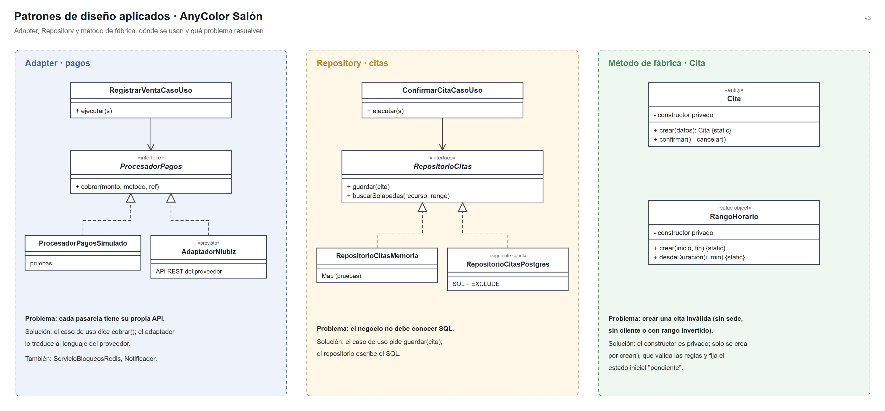

# Patrones de diseño

## Objetivo

Documentar los patrones de diseño aplicados en el backend de AnyColor Salón, indicando dónde se usan, qué problema resuelven y con qué se implementan, para que el código se escriba de forma uniforme.

## Contexto

- **Estilo:** monolito modular (Node.js + NestJS).
- **Enfoque interno:** Clean Architecture.
- **Base:** diagrama de componentes (C4 nivel 3) y diagrama de código del módulo Citas (nivel 4).

## Patrones aplicados

| Patrón | Dónde se usa | Problema que resuelve | Se implementa con | Archivos en el código |
|---|---|---|---|---|
| Adapter | Citas → Redis | El caso de uso no debe conocer los comandos de Redis | Cliente Redis (`SET NX PX`, script Lua) | `servicios-externos.contrato.ts`, `servicio-bloqueos-redis.ts` |
| Adapter | POS y Caja → pasarela de pagos | Cada pasarela (Niubiz, Izipay, Yape) tiene su propia API | SDK o API REST del proveedor | `ProcesadorPagos`, `adaptadores-simulados.ts` |
| Adapter | Notificaciones → WhatsApp / correo | Cambiar de canal sin tocar la reserva | API de mensajería | `Notificador`, `NotificadorConsola` |
| Repository | Todos los módulos → PostgreSQL | El negocio no debe conocer SQL | PostgreSQL (`pg` u ORM) | `repositorios.contrato.ts`, `repositorios-memoria.ts` |
| Método de fábrica estático | Entidades y objetos de valor | Impedir objetos inválidos (cita sin sede, rango invertido) | Constructor privado + `crear()` | `cita.modelo.ts`, `rango-horario.ts`, `venta.modelo.ts` |
| Idempotent Receiver | POS y Caja | Un reintento de red no debe cobrar ni descontar stock dos veces | `Idempotency-Key` + búsqueda previa | `registrar-venta.caso-uso.ts` |

## Cómo funciona cada patrón

| Patrón | En pocas palabras |
|---|---|
| Adapter | El sistema dice `adquirir(clave)` o `cobrar(monto)`; el adaptador lo convierte en la llamada propia de Redis o de la pasarela. |
| Repository | El caso de uso dice `guardar(cita)` o `buscarSolapadas(rango)`; el repositorio escribe el SQL. |
| Método de fábrica | Nadie hace `new Cita(...)`: se usa `Cita.crear(datos)`, que valida y deja la cita en estado *pendiente*. |
| Idempotent Receiver | Antes de cobrar se busca la venta por su clave; si existe, se devuelve la misma. |

## Beneficio

- Cambiar Redis, la pasarela, el canal de mensajería o la base de datos solo afecta al adaptador o al repositorio (AC07).
- Las pruebas usan implementaciones en memoria: 16 pruebas corren sin Redis ni PostgreSQL.
- Las reglas del salón están en un solo lugar: la entidad.

## Patrones previstos para siguientes iteraciones

| Patrón | Dónde se aplicaría | Cuándo |
|---|---|---|
| Decorator | Catálogo → caché Redis (`RepositorioServiciosEnCache`) | Al implementar la caché del catálogo (EQ-01) |
| Observer / eventos de dominio | Citas → Notificaciones, Inventario → Notificaciones | Al implementar la cola BullMQ (ADR-007) |
| Strategy | Cálculo de comisiones por tipo de servicio | Si el negocio define porcentajes distintos por categoría |
| Facade | API pública de cada módulo (`index.ts`) | Cuando los módulos crezcan y necesiten una única puerta de entrada |
