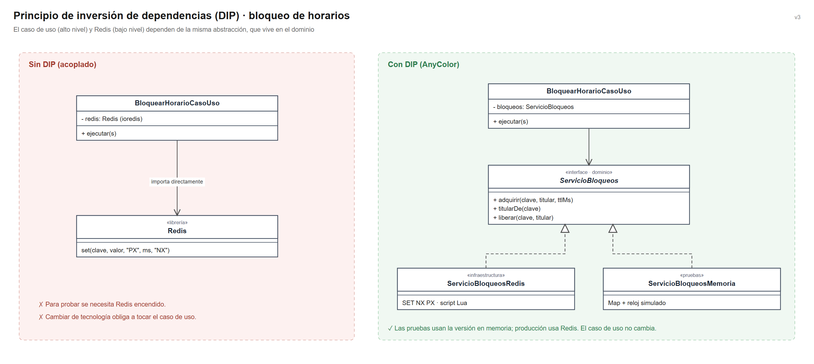

# Principios de diseño (SOLID)

## Objetivo

Documentar cómo se aplican los principios SOLID en el backend de AnyColor Salón, organizado con Clean Architecture, para que cada módulo se programe de forma uniforme y las reglas del salón no dependan de la tecnología.

## Contexto

- **Estilo:** monolito modular (Node.js + NestJS).
- **Enfoque interno:** Clean Architecture (presentación, aplicación, dominio, infraestructura).
- **Módulo de referencia:** Citas, porque integra Redis, PostgreSQL y notificaciones.

## SOLID en el módulo Citas

| Principio | Dónde se aplica (capa) | Cómo se cumple en AnyColor | Archivos |
|---|---|---|---|
| **S** · Responsabilidad única | Todas las capas | Cada clase tiene una sola tarea: el controlador traduce HTTP, `BloquearHorarioCasoUso` bloquea, `ConfirmarCitaCasoUso` confirma, `Cita` controla sus estados y `RangoHorario` detecta solapes | `citas.controlador.ts`, `bloquear-horario.caso-uso.ts`, `confirmar-cita.caso-uso.ts`, `cita.modelo.ts`, `rango-horario.ts` |
| **O** · Abierto/cerrado | Infraestructura | Para bloquear con otra tecnología se crea un nuevo adaptador de `ServicioBloqueos`; los casos de uso no se modifican | `servicio-bloqueos-redis.ts`, `servicio-bloqueos-memoria.ts` |
| **L** · Sustitución de Liskov | Infraestructura | Redis y memoria cumplen el mismo contrato (`adquirir` devuelve `false` si otro titular tiene el bloqueo vigente); las pruebas pasan con cualquiera | `servicio-bloqueos-redis.ts`, `servicio-bloqueos-memoria.ts` |
| **I** · Segregación de interfaces | Dominio | Contratos pequeños: `ServicioBloqueos` solo bloquea, `Notificador` solo notifica, `RepositorioServicios` solo consulta servicios | `servicios-externos.contrato.ts`, `repositorios.contrato.ts` |
| **D** · Inversión de dependencias | Aplicación | Los casos de uso reciben interfaces por el constructor y no conocen Redis ni PostgreSQL; las implementaciones se conectan en la raíz de composición | `bloquear-horario.caso-uso.ts`, `citas.module.ts` |

## Inversión de dependencias en el bloqueo de horarios

## Qué pasaría sin SOLID en AnyColor

| Situación real | Sin SOLID | Con SOLID |
|---|---|---|
| Se cambia la pasarela de pagos | Hay que modificar `RegistrarVenta` | Solo se crea un nuevo adaptador |
| Se quiere probar la reserva concurrente | Se necesita Redis y PostgreSQL encendidos | Se prueba con implementaciones en memoria y un reloj simulado |
| El bloqueo pasa de 5 a 10 minutos | Se busca el número en controladores y servicios | Se cambia `DURACION_BLOQUEO_MS` en `bloqueo.modelo.ts` |
| Cambia una regla de la cita | Hay que buscarla en varias pantallas | Está solo en la entidad `Cita` |

## Relación con Clean Architecture y los patrones

| Principio | Lo cumple en el proyecto |
|---|---|
| Responsabilidad única | La separación en capas de Clean Architecture |
| Abierto/cerrado y Liskov | El patrón Adapter (Redis, pasarela, mensajería) |
| Segregación de interfaces | Los contratos del dominio (`ServicioBloqueos`, `Notificador`, `RepositorioCitas`) |
| Inversión de dependencias | El patrón Repository y la regla de dependencia: las capas externas dependen del dominio |
