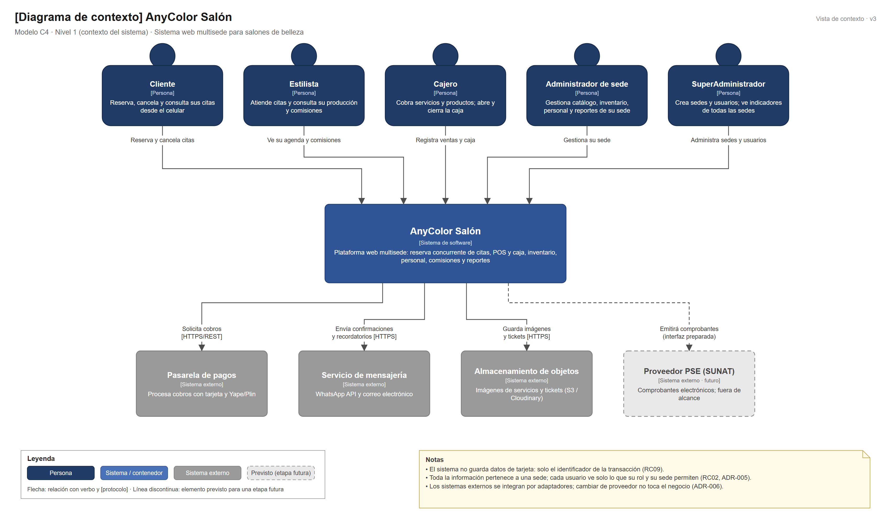

# Nivel 1 · Diagrama de contexto del sistema

> **Proyecto:** AnyColor Salón
> **Modelo:** C4 · Nivel 1 de 4 · **Versión:** 3.0

---

## 1. Objetivo

Mostrar **AnyColor Salón como una sola caja**: quiénes lo usan y con qué sistemas externos se comunica. Es la vista de mayor nivel y la primera que se presenta a cualquier persona, técnica o no.

| Aspecto | Descripción |
|---|---|
| Pregunta que responde | ¿Qué es el sistema, quién lo usa y con quién se integra? |
| Audiencia | Todos: dueño del salón, docentes, equipo de desarrollo, operaciones |
| Qué **no** muestra | Tecnologías, servidores, bases de datos ni módulos internos |
| Siguiente nivel | [Nivel2-DiagramadeContenedores.md](Nivel2-DiagramadeContenedores.md) |

---

## 2. Diagrama

> Archivo editable: [`img/fuentes/nivel1-contexto.drawio`](../../img/fuentes/nivel1-contexto.drawio)

---

## 3. Personas (usuarios)

| Persona | Descripción | Qué hace en el sistema | Origen |
|---|---|---|---|
| **Cliente** | Persona que reserva servicios del salón | Elige sede, servicio, estilista y horario; reserva, cancela y consulta sus citas | HU01, HU02, HU12 |
| **Estilista** | Profesional que atiende las citas | Ve su agenda, inicia y finaliza atenciones, consulta producción y comisiones | HU07 |
| **Cajero** | Responsable de la caja de una sede | Abre y cierra turno, registra ventas y cobra | HU03, HU04 |
| **Administrador de sede** | Encargado de una sede | Gestiona catálogo, inventario, personal y reportes de su sede | HU05, HU06, HU08, HU11 |
| **SuperAdministrador** | Dueño o gerente general | Crea sedes y usuarios, revisa indicadores consolidados y la auditoría | HU09, HU10, HU13 |

---

## 4. Sistemas

| Sistema | Tipo | Responsabilidad | Quién lo construye |
|---|---|---|---|
| **AnyColor Salón** | Sistema en alcance | Gestionar citas sin cruces, POS y caja, inventario por sede, personal, comisiones y reportes | El equipo del proyecto |
| **Pasarela de pagos** | Sistema externo | Procesar cobros con tarjeta y Yape/Plin | Proveedor de pagos |
| **Servicio de mensajería** | Sistema externo | Enviar confirmaciones y recordatorios por WhatsApp o correo | Proveedor de mensajería |
| **Almacenamiento de objetos** | Sistema externo | Guardar imágenes de servicios y tickets | S3 / Cloudinary |
| **Proveedor PSE (SUNAT)** | Sistema externo · futuro | Emitir comprobantes electrónicos; hoy fuera de alcance, interfaz preparada | Proveedor autorizado |

---

## 5. Relaciones

| Origen | Destino | Descripción | Protocolo |
|---|---|---|---|
| Cliente | AnyColor Salón | Reserva y cancela citas | — |
| Estilista | AnyColor Salón | Ve su agenda y comisiones | — |
| Cajero | AnyColor Salón | Registra ventas y caja | — |
| Administrador de sede | AnyColor Salón | Gestiona su sede | — |
| SuperAdministrador | AnyColor Salón | Administra sedes y usuarios | — |
| AnyColor Salón | Pasarela de pagos | Solicita cobros | HTTPS/REST |
| AnyColor Salón | Servicio de mensajería | Envía confirmaciones y recordatorios | HTTPS |
| AnyColor Salón | Almacenamiento de objetos | Guarda imágenes y tickets | HTTPS |
| AnyColor Salón | Proveedor PSE | Emitirá comprobantes (futuro) | Interfaz preparada |

> En el nivel 1 no se indica el protocolo entre personas y sistema: eso se detalla en el nivel 2.

---

## 6. Decisiones y supuestos

| # | Decisión o supuesto | Motivo |
|---|---|---|
| 1 | Los sistemas externos se integran mediante sus API | Es lo que ofrecen los proveedores; no se accede a sus bases de datos |
| 2 | AnyColor **no almacena datos de tarjeta** | Solo se guarda el identificador de la transacción (RC09) |
| 3 | Toda la información pertenece a una sede | Aislamiento multisede (RC02, ADR-005) |
| 4 | Los sistemas externos no se modifican | Son de terceros; AnyColor se adapta a ellos con el patrón Adapter (ADR-006) |

### Pendientes por definir

| Tema | Detalle |
|---|---|
| Proveedor de mensajería | Confirmar si será WhatsApp Business API, correo o ambos |
| Facturación electrónica | Elegir el PSE cuando el negocio decida emitir comprobantes SUNAT |
