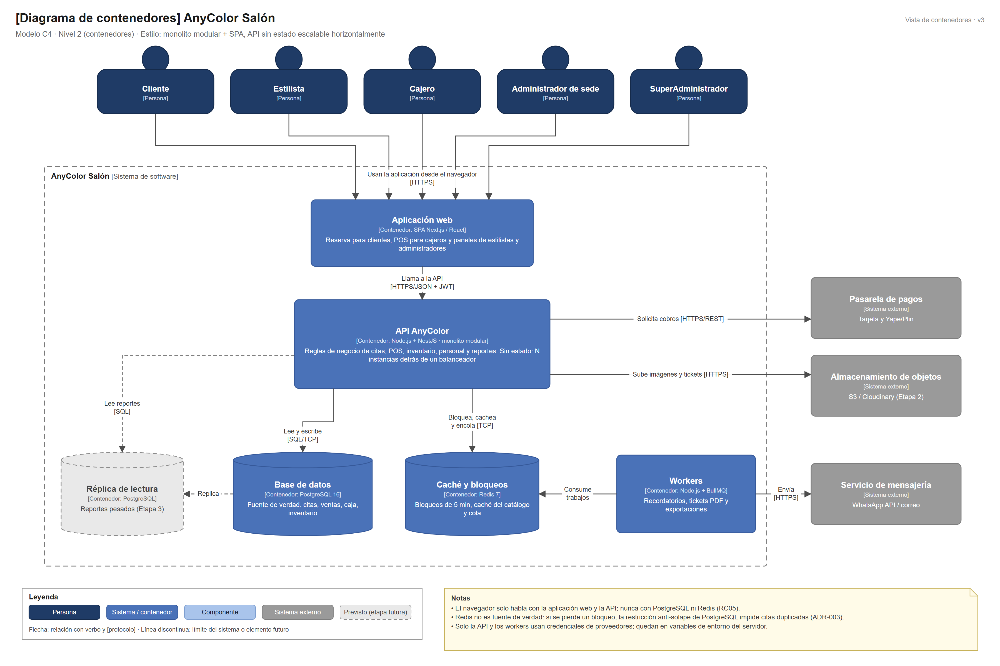

# Nivel 2 · Diagrama de contenedores

> **Proyecto:** AnyColor Salón
> **Modelo:** C4 · Nivel 2 de 4 · **Versión:** 3.0

---

## 1. Objetivo

Abrir la caja «AnyColor Salón» del nivel 1 y mostrar los **contenedores** que la forman: las aplicaciones y almacenes de datos que se ejecutan por separado, la tecnología de cada uno y cómo se comunican.

| Aspecto | Descripción |
|---|---|
| Pregunta que responde | ¿De qué piezas ejecutables se compone el sistema y con qué tecnología? |
| Audiencia | Arquitectos, desarrolladores, operaciones |
| Qué es un contenedor | Algo que se ejecuta o almacena datos de forma independiente: una aplicación web, una API, una base de datos (no es lo mismo que un contenedor Docker) |
| Nivel anterior | [Nivel1-DiagramadeContextodelSistema.md](Nivel1-DiagramadeContextodelSistema.md) |
| Siguiente nivel | [Nivel3-Diagrama-de-Componentes.md](Nivel3-Diagrama-de-Componentes.md) |

---

## 2. Diagrama

> Archivo editable: [`img/fuentes/nivel2-contenedores.drawio`](../../img/fuentes/nivel2-contenedores.drawio)

---

## 3. Contenedores

| Contenedor | Tecnología | Responsabilidad | Datos que maneja |
|---|---|---|---|
| **Aplicación web** | SPA · Next.js / React | Reserva para clientes, POS para cajeros y paneles de estilistas y administradores. Se ejecuta en el navegador y se publica en CDN | Ninguno persistente; solo el estado de la pantalla |
| **API AnyColor** | Node.js + NestJS | Expone la API REST, aplica las reglas del salón e integra los sistemas externos. Es un **monolito modular** sin estado: N instancias detrás de un balanceador | Ninguno propio; usa la base de datos y Redis |
| **Base de datos** | PostgreSQL 16 | Fuente de verdad transaccional (ACID) con restricción anti-solape | Sedes, usuarios, servicios, citas, ventas, caja, inventario, comisiones, auditoría |
| **Caché y bloqueos** | Redis 7 | Bloqueos temporales de 5 minutos, caché del catálogo y cola de trabajos | Copias temporales; no es fuente de verdad |
| **Workers** | Node.js + BullMQ | Recordatorios, tickets PDF y exportaciones en segundo plano | Leen trabajos de la cola |
| **Réplica de lectura** | PostgreSQL (Etapa 3) | Reportes pesados sin cargar la base principal | Copia de solo lectura |

---

## 4. Relaciones

| Origen | Destino | Descripción | Protocolo |
|---|---|---|---|
| Personas | Aplicación web | Usan la aplicación desde el navegador | HTTPS |
| Aplicación web | API AnyColor | Llama a la API | HTTPS/JSON + JWT |
| API AnyColor | Base de datos | Lee y escribe | SQL sobre TCP |
| API AnyColor | Caché y bloqueos | Bloquea horarios, cachea y encola | TCP |
| Workers | Caché y bloqueos | Consumen trabajos | TCP (BullMQ) |
| Base de datos | Réplica de lectura | Replica los datos | Replicación PostgreSQL |
| API AnyColor | Réplica de lectura | Lee reportes | SQL |
| API AnyColor | Pasarela de pagos | Solicita cobros | HTTPS/REST |
| API AnyColor | Almacenamiento de objetos | Sube imágenes y tickets | HTTPS |
| Workers | Servicio de mensajería | Envían mensajes | HTTPS |

---

## 5. Decisiones arquitectónicas reflejadas

| Decisión | Alternativa descartada | Motivo | ADR |
|---|---|---|---|
| Un único contenedor de backend (monolito modular) | Microservicios | Venta, inventario, caja y comisión necesitan transacción local; equipo pequeño | ADR-001 |
| API sin estado replicada | Sesión en memoria del servidor | Permite agregar instancias en campañas (DA02) | ADR-001, ADR-005 |
| Frontend separado (SPA + API REST) | Páginas generadas en el servidor | Frontend y backend evolucionan y se despliegan por separado | ADR-010 |
| PostgreSQL como fuente de verdad | Base de datos NoSQL | Citas, ventas, caja y stock necesitan transacciones y la restricción `EXCLUDE` | ADR-003 |
| Redis para bloqueos y caché | Bloquear solo en la base de datos | `SET NX PX` es atómico y rápido; reduce la contención en PostgreSQL | ADR-004 |
| Workers separados | Enviar mensajes dentro de la petición | Los recordatorios no deben frenar la caja ni la reserva | ADR-007 |

---

## 6. Seguridad entre contenedores

| Comunicación | Medida |
|---|---|
| Navegador → aplicación web y API | Tráfico cifrado con HTTPS/TLS; CDN con WAF |
| Aplicación web → API | Token JWT con rol y `sedeId` en cada petición |
| API → base de datos y Redis | Acceso solo desde la red interna; credenciales en variables de entorno |
| API y workers → sistemas externos | Credenciales de proveedores solo en el servidor; nunca en el navegador |
