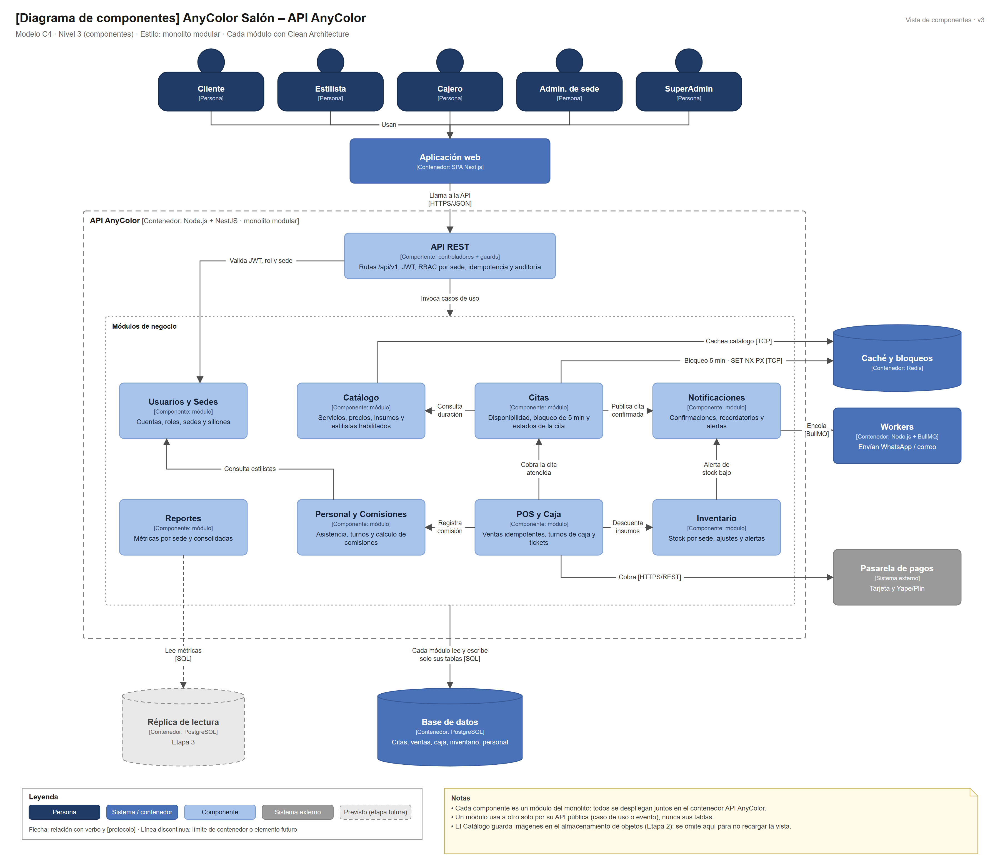

# Nivel 3 · Diagrama de componentes

> **Proyecto:** AnyColor Salón · **Contenedor detallado:** API AnyColor
> **Modelo:** C4 · Nivel 3 de 4 · **Versión:** 3.0

---

## 1. Objetivo

Abrir el contenedor **API AnyColor** del nivel 2 y mostrar sus **componentes**: los módulos del monolito modular, la responsabilidad de cada uno y cómo se relacionan entre sí y con la base de datos, Redis y los sistemas externos.

| Aspecto | Descripción |
|---|---|
| Pregunta que responde | ¿Cómo se divide el backend por dentro y qué hace cada parte? |
| Audiencia | Arquitectos y desarrolladores |
| Qué es un componente | Un grupo de funcionalidades con una responsabilidad clara, accesible mediante una interfaz. En este proyecto cada **módulo** del monolito es un componente |
| Nivel anterior | [Nivel2-DiagramadeContenedores.md](Nivel2-DiagramadeContenedores.md) |
| Siguiente nivel | [Nivel4-DiagramadeCodigo.md](Nivel4-DiagramadeCodigo.md) |

---

## 2. Diagrama

> Archivo editable: [`img/fuentes/nivel3-componentes.drawio`](../../img/fuentes/nivel3-componentes.drawio)

---

## 3. Componentes

| Componente | Responsabilidad | Funcionalidades principales | Carpeta en el código | Sale de |
|---|---|---|---|---|
| **API REST** | Punto de entrada HTTP | Rutas `/api/v1`, JWT, RBAC por sede, validación, idempotencia, auditoría, manejo de errores | `src/api/` | RF02, RF23, DA04 |
| **Usuarios y Sedes** | Identidad y acceso | Registro, inicio de sesión, roles, sedes y sillones | `src/modules/usuarios/` | RF01–RF03 |
| **Catálogo** | Oferta del salón | Servicios, precios, duración, insumos y estilistas habilitados | `src/modules/catalogo/` | RF04 |
| **Citas** | Motor de reservas | Disponibilidad, bloqueo de 5 minutos, confirmación y estados | `src/modules/citas/` | RF05–RF08, DA01 |
| **POS y Caja** | Ventas | Ventas idempotentes, cobros, turnos de caja y tickets | `src/modules/pos/` | RF09–RF11, RF18 |
| **Inventario** | Existencias por sede | Descuento transaccional, ajustes, alertas de stock | `src/modules/inventario/` | RF12–RF14 |
| **Personal y Comisiones** | Colaboradores | Asistencia, turnos y comisión por servicio finalizado | `src/modules/personal/` | RF15–RF17 |
| **Reportes** | Indicadores | Métricas por sede y consolidadas, exportación CSV/Excel | `src/modules/reportes/` | RF19–RF21, RF24 |
| **Notificaciones** | Comunicación | Confirmaciones, recordatorios y alertas encoladas | `src/modules/notificaciones/` | RF22 |

---

## 4. Relaciones entre componentes

| Origen | Destino | Descripción | Tipo de comunicación |
|---|---|---|---|
| Aplicación web | API REST | Llama a la API | HTTPS/JSON |
| API REST | Módulos de negocio | Invoca los casos de uso | Llamada en memoria |
| API REST | Usuarios y Sedes | Valida JWT, rol y sede | Llamada en memoria |
| Citas | Catálogo | Consulta duración y estilistas habilitados | Llamada en memoria (API pública) |
| Citas | Notificaciones | Publica la cita confirmada | Evento en memoria |
| POS y Caja | Citas | Cobra la cita atendida | Llamada en memoria |
| POS y Caja | Personal y Comisiones | Registra la comisión del servicio | Llamada en memoria |
| POS y Caja | Inventario | Descuenta insumos y productos | Llamada en memoria (misma transacción) |
| Inventario | Notificaciones | Alerta de stock bajo | Evento en memoria |
| Personal y Comisiones | Usuarios y Sedes | Consulta estilistas | Llamada en memoria |

---

## 5. Relaciones con contenedores y sistemas externos

| Componente | Destino | Descripción | Protocolo | Patrón aplicado |
|---|---|---|---|---|
| Todos los módulos | Base de datos (PostgreSQL) | Cada módulo lee y escribe **solo sus propias tablas** | SQL | Repository |
| Citas | Redis | Bloqueo de 5 minutos (`SET NX PX`) | TCP | Adapter |
| Catálogo | Redis | Caché del catálogo | TCP | Decorator (previsto) |
| Notificaciones | Workers | Encola mensajes | BullMQ | Adapter |
| POS y Caja | Pasarela de pagos | Cobra con tarjeta o Yape/Plin | HTTPS/REST | Adapter |
| Reportes | Réplica de lectura | Lee métricas (Etapa 3) | SQL | Repository |

---

## 6. Reglas del monolito modular

| # | Regla | Motivo |
|---|---|---|
| 1 | Todos los componentes se despliegan juntos en el contenedor API AnyColor | Es un monolito: un solo proceso y un solo despliegue |
| 2 | Un módulo usa a otro solo a través de su API pública (`index.ts`) o de un evento | Un cambio interno no rompe a los demás |
| 3 | Un módulo no lee ni escribe las tablas de otro módulo | Mantiene la independencia de los datos |
| 4 | Cada sistema externo se integra en un único módulo | La integración queda en un solo lugar y es fácil de reemplazar |
| 5 | Cada módulo se organiza por dentro con Clean Architecture | Las reglas del salón no dependen de la tecnología (ver nivel 4) |
